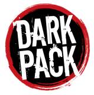

# Monde des Ténèbres (Homebrew) — système Foundry VTT

Système de jeu **maison** pour [Foundry Virtual Tabletop](https://foundryvtt.com), destiné aux parties du Monde des Ténèbres « classique » (éditions 20e anniversaire) : **Mortel, Vampire, Goule, Garou, Mage**.

> **Version de Foundry ciblée : V14, build 369 (`14.369`).**
> Le système est développé et testé sur ce build précis. Le build cible **évoluera** avec les mises à jour de Foundry ;
> le [CHANGELOG](CHANGELOG.md) indique pour chaque version le build sur lequel elle a été vérifiée.

Version actuelle du système : **0.2.0** · Statut : **en développement** (étape 2 sur 8)

## Ce que fait le système aujourd'hui

| Fonction | Statut |
|---|---|
| 5 types de personnage (Mortel, Vampire, Goule, Garou, Mage) avec base commune | ✅ |
| Choix du jeu par fiche (V20, Dark Ages V20, W20, M20), qui change la liste de capacités | ✅ |
| Attributs, capacités, capacités secondaires, historiques, atouts, handicaps | ✅ |
| Volonté, santé (niveaux, dégâts contondants / létaux / aggravés, malus calculé) | ✅ |
| Champs de créature : clan, génération, vertus, voie, sang · rage, gnose, renommée, dons, rites, fétiches · sphères, arété, quintessence, paradoxe | ✅ |
| Objets : arme, armure, divers | ✅ |
| Notes réservées au MJ | ✅ |
| Interface en français | ✅ |
| Points cliquables, couleur par créature, en-tête compacte | ✅ |
| Capacités secondaires par colonne, spécialités | ✅ |
| Listes préfaites (historiques, atouts, handicaps, archétypes, clans, tribus, traditions…) | ✅ |
| Panneau du MJ et « Traits de la chronique » (renommer, masquer, ajouter des traits) | ✅ |
| Scène et image d'accueil | ✅ |
| Jets de dés, malus de santé, pouvoirs, compendiums | ❌ à venir |

## Installation (développement)

Clonez le dépôt dans le dossier des systèmes de Foundry, sous le nom `wod_homebrew` :

```bash
git clone https://github.com/Nave20/foundry-wod-homebrew "<dossier de données Foundry>/Data/systems/wod_homebrew"
```

Le dossier de données se trouve par défaut dans `%LOCALAPPDATA%/FoundryVTT` (Windows), `~/Library/Application Support/FoundryVTT` (macOS) ou `~/.local/share/FoundryVTT` (Linux).
Redémarrez ensuite Foundry (il ne détecte les nouveaux systèmes qu'au démarrage), puis créez un monde avec « Monde des Ténèbres (Homebrew) ».

## Feuille de route

1. ✅ Modèle de données et fiche simple
2. ✅ Mise en page de la fiche
3. ⏳ Jets de dés (réserve de d10, difficulté, succès, échecs critiques)
4. Malus de santé et dépense de Volonté dans les jets
5. Armes et armures reliées aux jets
6. Pouvoirs de créature (disciplines, dons, rites, sphères)
7. Import de personnages depuis des fiches Markdown
8. Compendiums

## Journal des sessions

Chaque session de travail se termine par un envoi sur ce dépôt, avec son récapitulatif dans le [CHANGELOG](CHANGELOG.md).

| Date | Version | Résumé |
|---|---|---|
| 2026-10-15 | 0.1.0 | Modèle de données des 5 créatures, fiche simple à onglets, objets, interface française |
| 2026-11-06 | 0.2.0 | Points cliquables, couleurs, listes préfaites, spécialités, Panneau du MJ, Traits de la chronique, scène d'accueil |

## Développement

Ce système est construit avec le skill Claude [foundry-v14-system](https://github.com/Nave20/foundry-v14-system-skill).
Le code utilise uniquement l'API V14 : `TypeDataModel`, ApplicationV2 avec Handlebars, et `documentTypes` à la place de `template.json`.

## Mentions légales



Portions of the materials are the copyrights and trademarks of Paradox Interactive AB, and are used with permission. All rights reserved. For more information please visit [worldofdarkness.com](https://www.worldofdarkness.com).

<br clear="left">

**This is not official World of Darkness material.** Création de fans gratuite et non commerciale, réalisée dans le cadre du [Dark Pack](https://www.paradoxinteractive.com/games/world-of-darkness/community/dark-pack-agreement). Ce projet n'est ni affilié ni approuvé par Paradox Interactive ou Foundry Gaming LLC.

- L'image d'accueil (`assets/accueil-4k.webp`) est faite à partir d'une illustration et du logo Dark Pack du pack gratuit *World of Darkness Community Assets* de Paradox.
- Le dépôt ne contient aucun texte de règles des livres : seulement les noms de traits nécessaires aux fiches. Il faut posséder les livres de base pour jouer.

Le code est distribué sous licence [MIT](LICENSE).
